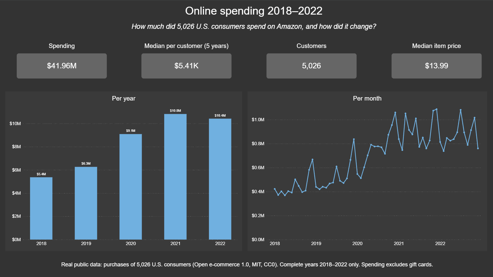
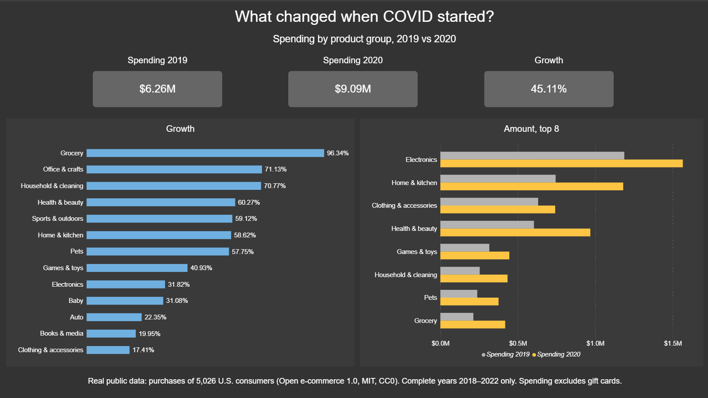
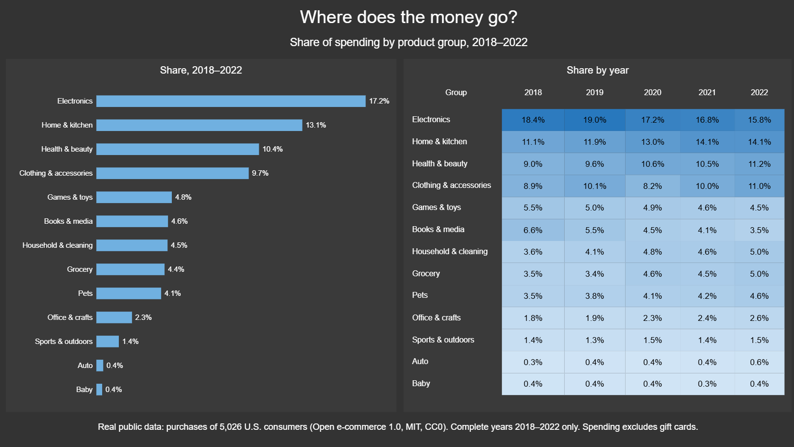
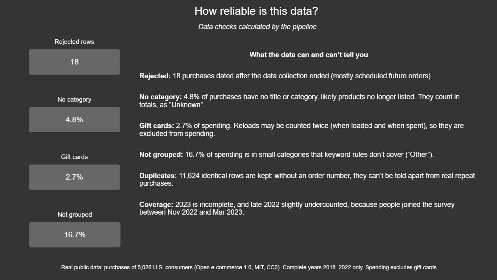

# Consumer Spending Pipeline


> **Portfolio project with real public data.** Purchase histories of 5,027
> U.S. Amazon.com consumers, 2018 – early 2023 (1,850,717 purchases),
> crowdsourced with informed consent by MIT researchers. Not affiliated with
> or endorsed by Amazon.

> **How it was built:** a hands-on learning project, built with an AI assistant (Claude).
> I made the design decisions, ran and checked every step, and fixed the problems listed below.

[](https://app.powerbi.com/view?r=eyJrIjoiNjFmZjI2NWItODBjOS00YWI0LTg3MmYtNjg0MmM0OGUwYzEzIiwidCI6ImU3NzQ1ODE4LTA3MDItNDk5Yy1iMWY1LTkzZmViOTkzOTQ4ZCJ9)
**← click to open the interactive dashboard (no login needed)**

> **At a glance**
> - One real 300 MB file → Azure → dbt star schema → 4-page Power BI report
> - Profiled first: 8 checks, every finding and decision documented
> - 15 dbt tests, including a test that guards the category rules
> - Built with CLI commands saved in a script, so Azure can be rebuilt from one file



## Business question
How did online spending change between 2018 and 2022, before, during and
after COVID-19 — which product groups grew, which shrank, and when?

## What the data shows
- **Spending jumped 45 % in 2020** ($6.26M → $9.09M) and stayed high in 2021–2022.
- **Everyday essentials grew most:** Grocery +96 %, Household & cleaning +71 %,
  Office & crafts +71 %, Health & beauty +60 %. Clothing grew least (+17 %).
- **The mix shifted for good:** Books & media fell from 6.6 % to 3.5 % of spending,
  Electronics from 18.4 % to 15.8 %; Home & kitchen rose from 11.1 % to 14.1 %.
- **Every year peaks in the holiday season.**
- The typical customer spent **$5,410 over five years** (median; the average is
  higher because a few heavy buyers pull it up). The median item cost **$13.99**.

| COVID effect | Categories | Data quality |
|---|---|---|
|  |  |  |

## Architecture
```
CSV (Harvard Dataverse, MD5-verified)
   → Azure Blob Storage (landing zone, file unchanged)
   → Azure Data Factory (one Copy step into a staging table, all text)
   → Azure SQL Database (free offer, serverless)
   → dbt (staging → intermediate → marts, 15 tests)
   → Power BI (4 pages, published to web)
```

## What is built
- **Download script** (`scripts/download_data.py`) — fetches the file and verifies its MD5 fingerprint.
- **Profiling notebook** (`notebooks/01_profiling.ipynb`) — 8 checks: duplicates, distinct values,
  common values, outliers, connected missing values, gaps over time, correlations, text hygiene.
- **Azure setup** (`scripts/azure_setup.ps1`, `sql/setup/`) — every resource, role and firewall
  rule as a command, so the setup can be rebuilt.
- **Data Factory** (`adf/`) — one Copy activity with retries; saved through ADF Git integration.
- **dbt** (`dbt/`):
  - staging: English names, safe type conversion, nothing hidden
  - intermediate: "Unknown" labels, gift card flag, 16 product groups from keyword rules,
    validation with written reasons
  - marts: `fact_purchases` (grain: one valid purchased item), `dim_date`, `dim_category`,
    `dim_customer`, `dq_summary`
- **Power BI** (`powerbi/`) — saved as a Power BI project (text files), DAX measures
  incl. `CALCULATE`, `DATEADD`, `REMOVEFILTERS` and `MEDIANX`.
- **CI** — GitHub Actions runs Ruff and `dbt parse` on every push.

## Known limitations
| Topic | What it means |
|---|---|
| **Rejected** | 18 purchases are dated after data collection ended — mostly scheduled future orders. |
| **No category** | 4.8 % of purchases have no title or category (likely products no longer listed); counted as "Unknown". |
| **Gift cards** | 2.7 % of spending. Reloads may be counted twice (loaded + spent), so they are excluded from spending. |
| **Not grouped** | 16.7 % of spending is in small categories the keyword rules don't cover ("Other"). Rules stopped at ~78 % coverage. |
| **Duplicates** | 11,624 identical rows are kept: without an order number they can't be told apart from repeat purchases. |
| **Coverage** | 2023 is incomplete and late 2022 slightly undercounted — people joined the survey Nov 2022 – Mar 2023. |

## Things found along the way
- **One inch sign broke the load:** a title like `8"" HD Display` made Data Factory split rows
  into extra columns until the CSV escape character matched the file.
- **Gift cards had four spellings** (`GIFT_CARD`, `ABIS_GIFT_CARD`, `ELECTRONIC_GIFT_CARD`,
  `Ecard Gift Certificate`); the first rule caught only two.
- **Rule order matters:** `TABLETOP_GAME` contains `TABLET` — 7,176 board games landed in
  Electronics until a dbt test caught it.
- **Case-insensitive database:** `Kitchen` and `KITCHEN` are one value in SQL Server but two in
  pandas, so categories are stored in upper case.
- **17 purchases from the future:** dated May–Sept 2023, after collection ended — scheduled
  subscription orders, rejected by a dbt rule that profiling had missed.

## Data source
Berke, A., Calacci, D., Mahari, R., Yabe, T., Larson, K., & Pentland, S. (2023).
*Open e-commerce 1.0: Five years of crowdsourced U.S. Amazon purchase histories with user
demographics.* Harvard Dataverse. https://doi.org/10.7910/DVN/YGLYDY

- License: **CC0 1.0** (public domain). Collection approved by the MIT Institutional Review Board.
- Only the purchases file is used; the survey file (demographics, health) is intentionally not
  used (data minimisation).

## Security and costs
- No passwords anywhere: Data Factory uses its managed identity, people and dbt log in with
  Microsoft Entra ID; roles follow least privilege.
- Free Azure SQL offer with auto-pause; one load costs a few cents.

## How to run
Requirements: Python 3.12, Git, Azure CLI, ODBC Driver 18 for SQL Server.

```powershell
git clone https://github.com/jurajpijakdata/consumer-spending-pipeline.git
cd consumer-spending-pipeline
py -3.12 -m venv .venv
.venv\Scripts\Activate.ps1
python -m pip install -r requirements.txt

python scripts/download_data.py      # downloads and verifies the data
az login                             # then see scripts/azure_setup.ps1
cd dbt
dbt build                            # builds and tests all models
```

## Documentation
- [`docs/profiling.md`](docs/profiling.md) — what the data looks like
- [`docs/decisions.md`](docs/decisions.md) — what was decided, and why
- [`docs/runbook.md`](docs/runbook.md) — problems met and how to fix them
